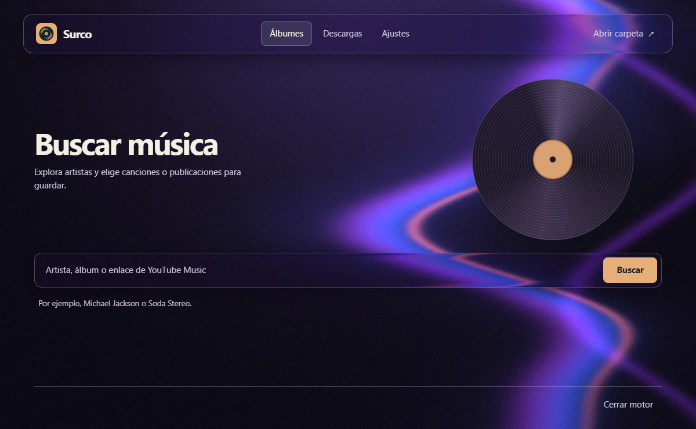

# Surco

Surco busca álbumes en YouTube Music y organiza sus pistas en una biblioteca local de Windows. Cada archivo conserva el orden de la edición elegida, sus etiquetas, la portada y la letra cuando está disponible.



## Instalación en Windows

Instala [Rust estable](https://rust-lang.org/tools/install/) con las herramientas de compilación C++ de Visual Studio, [Python 3.14](https://www.python.org/downloads/), [Node.js 24](https://nodejs.org/) y [FFmpeg](https://ffmpeg.org/download.html). Comprueba que `cargo`, `python`, `node` y `ffmpeg` estén en `PATH`. Surco también admite copias locales de `node.exe` y `ffmpeg.exe` en `runtime/`.

Desde la carpeta del proyecto, ejecuta en PowerShell:

```powershell
powershell -ExecutionPolicy Bypass -File .\Preparar.ps1
powershell -ExecutionPolicy Bypass -File .\Compilar.ps1
```

Abre **Iniciar Surco.cmd**. El motor escucha en `127.0.0.1:8737` y abre una ventana de Edge o el navegador predeterminado. **Cerrar motor** pausa el trabajo activo. Si solo cierras la ventana, la cola sigue funcionando.

## Descargar una edición

Busca un artista y abre **Canciones**, **Álbumes** o **Sencillos y EP**. Puedes marcar varias canciones y publicaciones en una sola selección. Marca **Completo** para guardar todas las pistas disponibles de una publicación o ábrela para elegir pistas concretas. Pulsa **Descargar selección** para añadirlas a la cola.

También puedes buscar por título o pegar el enlace de un álbum. Si el catálogo agrupa varias publicaciones, abre **Otras ediciones** en su ficha.

Surco toma el identificador de audio oficial de la lista de la edición elegida. Comprueba posición, título y artista. Contrasta la duración disponible con la ficha del álbum y verifica el archivo antes de guardarlo. Si la fuente resulta ambigua o no está disponible, la pista queda pendiente con un motivo. La verificación usa metadatos del catálogo y del archivo.

Los formatos son MP3 a 320 kbps y M4A/AAC de origen. Puedes cambiar el formato y el destino en **Ajustes**. La carpeta predeterminada es `%USERPROFILE%\Music\Surco`. Usa Surco con contenido que tengas permiso de descargar.

Surco reutiliza archivos locales cuya fuente y duración coinciden.

## Código y pruebas

- `src/` contiene el servidor local, la cola y la publicación de archivos en Rust.
- `bridge/` conecta el catálogo, la descarga y las etiquetas con ytmusicapi, yt-dlp y Mutagen.
- `web/` contiene la interfaz integrada en el ejecutable.
- `tests/` contiene pruebas y muestras reducidas de catálogo. `Compilar.ps1` ejecuta las pruebas de Rust, Python y JavaScript antes de compilar.

El perfil local queda en `data/`. Para ejecutar una prueba con configuración y cola propias, define `SURCO_DATA` con la ruta de una carpeta temporal.

La refracción de la interfaz usa [Glasswork v1.1.0](https://github.com/kubai087/glasswork/tree/v1.1.0). Su [licencia MIT](web/vendor/glasswork/LICENSE) se conserva junto al módulo.
