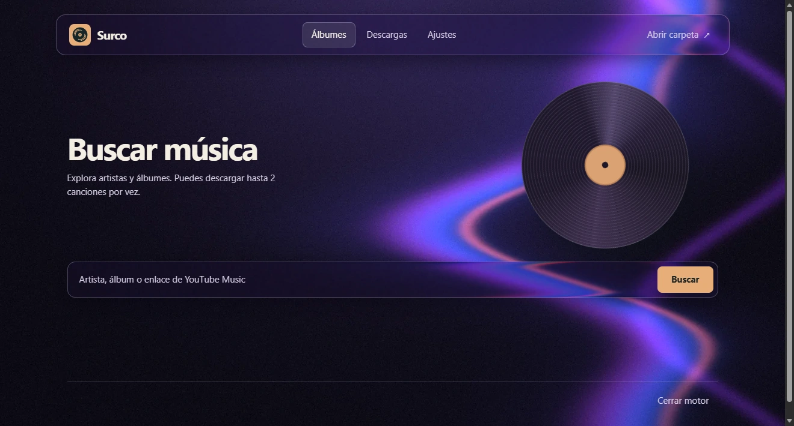
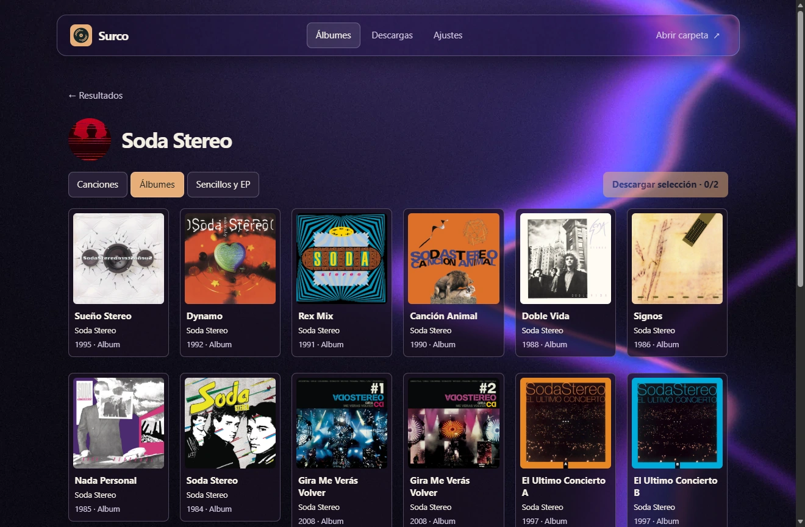
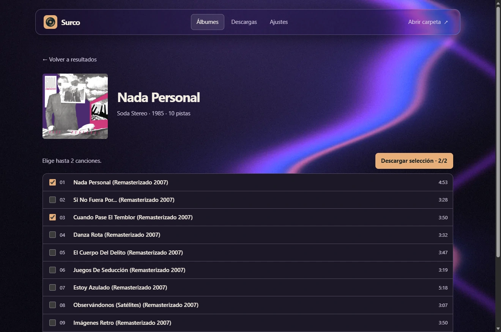

<p align="center"></p>
<h1 align="center">Surco</h1>
<p align="center">Busca en YouTube Music y guarda hasta dos canciones por descarga en MP3 o M4A.</p>
<p align="center"><strong><a href="../../releases/download/v1.0.0/Surco-1.0.0-windows-x64.zip">Descargar para Windows</a></strong> · <a href="#capturas">Capturas</a> · <a href="docs/uso.md">Guía de uso</a> · <a href="docs/compilar.md">Compilar</a></p>



## Empezar en tres pasos

1. Descarga el ZIP portable para **Windows 10 u 11 de 64 bits**. Python, Node.js y FFmpeg vienen en el paquete.
2. Haz clic derecho sobre el ZIP, elige **Extraer todo** y abre `surco.exe` en la carpeta extraída. Surco se abre en Edge o en tu navegador predeterminado.
3. Busca un **artista**, un **álbum** o pega un **enlace de álbum de YouTube Music**. Marca una o dos pistas y pulsa **Descargar selección**.

En **Descargas** puedes ver el progreso, pausar o reintentar pistas y abrir la carpeta de los archivos guardados. **Ajustes** permite cambiar la carpeta y elegir el formato de audio.

## Capturas

### Explorar las publicaciones de un artista

Busca **Soda Stereo**, abre la ficha del artista y elige **Álbumes**. La ficha también tiene pestañas para canciones, sencillos y EP.



### Elegir dos canciones de una edición

En **Nada Personal**, marcamos **Nada Personal** y **Cuando Pase El Temblor**. El botón muestra **2/2**. También puedes combinar pistas de publicaciones distintas.



## Archivos y formatos

| Opción | Para qué sirve |
| --- | --- |
| **MP3 · 320 kbps** | Convierte el audio a un formato compatible con muchos reproductores. |
| **M4A · audio AAC original** | Conserva el audio AAC que ofrece la fuente, cuando está disponible. |
| **Carpeta de música** | Guarda los archivos por artista, año y álbum. La ubicación inicial es `%USERPROFILE%\Music\Surco`. |

Las pistas conservan sus etiquetas, el orden de la edición, la portada y la letra cuando la fuente los ofrece. Para ver estados de descarga, instalación desde cero y soluciones a problemas habituales, consulta la [guía de uso](docs/uso.md).

## Código y compilación

| Carpeta | Tecnología | Qué hace |
| --- | --- | --- |
| [`src/`](src) | Rust · Axum · Tokio | Ejecutable de Windows, servidor local, cola y guardado de archivos. |
| [`web/`](web) | HTML · CSS · JavaScript | Interfaz del buscador, las descargas y los ajustes. |
| [`bridge/`](bridge) | Python · ytmusicapi · yt-dlp · Mutagen | Consulta del catálogo, obtención del audio y escritura de etiquetas. |
| [`tests/`](tests) | Rust · Python · JavaScript · PowerShell | Pruebas de selección, catálogo, audio y arranque portable. |

Node.js ejecuta el JavaScript que utiliza yt-dlp para resolver desafíos de YouTube. FFmpeg prepara y verifica el audio.

Para generar el ZIP desde el código, abre PowerShell en la carpeta de `Cargo.toml` y ejecuta el script con los [requisitos de compilación](docs/compilar.md) instalados.

```powershell
powershell -ExecutionPolicy Bypass -File .\Empaquetar.ps1
```

El script compila el `.exe`, incluye las dependencias y prueba el ZIP antes de guardarlo en `dist/`.

## Licencias

La licencia del código propio de Surco está por definir. Los componentes incluidos se distribuyen con sus licencias. Entre las principales están **MIT** para Node.js, Glasswork y ytmusicapi, **PSF v2** para Python, **GPLv3** para la compilación incluida de FFmpeg, **GPL-2.0-or-later** para Mutagen y **Unlicense** para yt-dlp. El ZIP contiene sus avisos y textos de licencia. [Licencias, versiones y fuentes de los componentes](docs/componentes.md)
